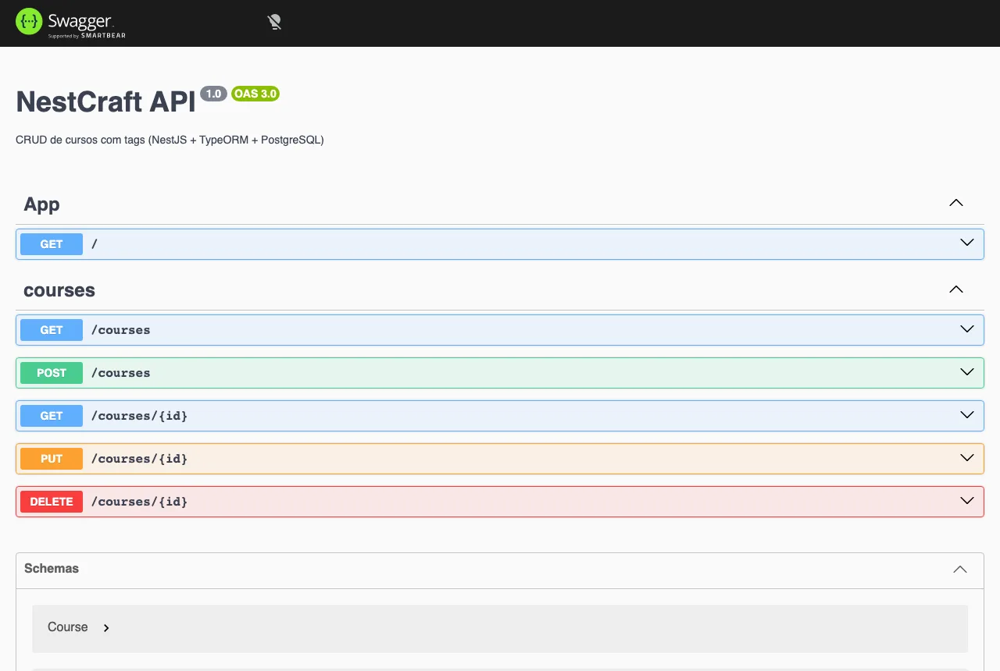
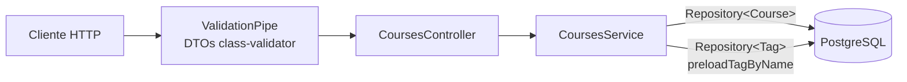
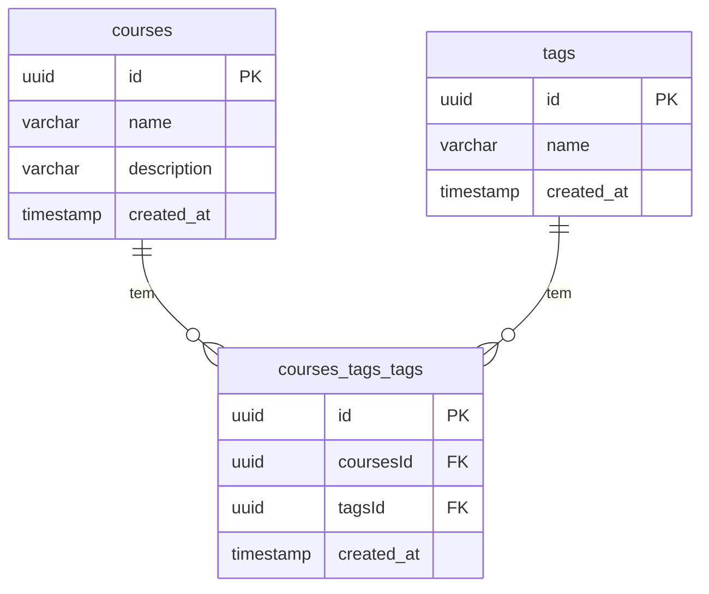
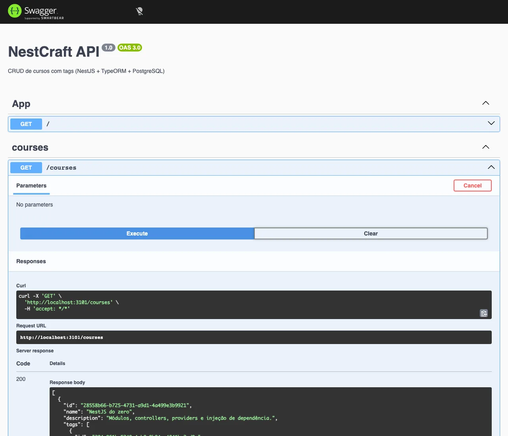

# NestCraft Backend

API REST de cursos com tags, feita em NestJS + TypeORM + PostgreSQL enquanto eu estudava NestJS do zero: módulos, DTOs validados, relação many-to-many, migrations versionadas e testes unitários e E2E.



## Funcionalidades

- CRUD de cursos (`/courses`) com tags.
- Tags são reaproveitadas pelo nome: ao criar ou editar um curso com `["backend"]`, a tag existente é usada; se não existir, é criada junto (cascade).
- Validação global com `ValidationPipe` (`whitelist`, `forbidNonWhitelisted`, `transform`): campo desconhecido no body retorna 400.
- `PUT /courses/:id` aceita body parcial (`PartialType` do DTO de criação).
- Documentação interativa Swagger em `/docs` (spec JSON em `/docs-json`).
- Migrations TypeORM versionadas; `synchronize` desligado.

## Como funciona



Modelo de dados (criado pelas migrations em `src/migrations`):



## Stack

NestJS 11, TypeScript, TypeORM 0.3, PostgreSQL, class-validator, @nestjs/swagger, Jest + Supertest, Docker Compose (bancos de dev e de teste).

## Como rodar

Pré-requisitos: Node.js 20+, Docker.

```bash
npm install
cp .env.example .env            # DB_HOST, DB_PORT, DB_USER, DB_PASS, DB_NAME
docker compose up -d db         # Postgres de dev na porta 5432 (banco "nestcraft")
npm run typeorm -- migration:run -d src/database/orm-cli-config.ts
npm run start:dev               # http://localhost:3000
```

Abra `http://localhost:3000/docs` para testar pelo Swagger.

| Variável | Exemplo (`.env.example`) | Uso |
| --- | --- | --- |
| `DB_HOST` | `localhost` | host do Postgres |
| `DB_PORT` | `5432` | porta do Postgres |
| `DB_USER` | `postgres` | usuário |
| `DB_PASS` | `docker` | senha (igual ao `docker-compose.yml`) |
| `DB_NAME` | `nestcraft` | banco |
| `PORT` | (opcional) | porta da API, padrão 3000 |

Build de produção: `npm run build && npm run start:prod`.

Outros comandos de migration:

```bash
npm run typeorm -- migration:revert -d src/database/orm-cli-config.ts
npm run typeorm -- migration:show -d src/database/orm-cli-config.ts
```

## API

| Método | Rota | Descrição | Respostas |
| --- | --- | --- | --- |
| GET | `/` | hello world | 200 |
| GET | `/courses` | lista cursos com tags | 200 |
| GET | `/courses/:id` | busca um curso | 200, 404 |
| POST | `/courses` | cria curso | 201, 400 |
| PUT | `/courses/:id` | atualiza (parcial) | 200, 400, 404 |
| DELETE | `/courses/:id` | remove | 204, 404 |

Body de criação (`name`, `description` até 300 caracteres e `tags` são obrigatórios):

```json
{
  "name": "NestJS do zero",
  "description": "Módulos, controllers, providers e injeção de dependência.",
  "tags": ["nestjs", "backend"]
}
```

Resposta de erro de validação:

```json
{
  "message": ["name must be a string", "each value in tags must be a string"],
  "error": "Bad Request",
  "statusCode": 400
}
```

Documentação da API:

- Swagger UI: `http://localhost:3000/docs` com a API rodando.
- OpenAPI 3: [`docs/openapi.json`](docs/openapi.json) (exportado de `/docs-json`; abre em [editor.swagger.io](https://editor.swagger.io)).
- Postman: importe [`docs/postman/nestcraft-backend.postman_collection.json`](docs/postman/nestcraft-backend.postman_collection.json). A variável `baseUrl` vem como `http://localhost:3000`; a requisição "Criar curso" salva o id em `courseId` para as próximas.



## Estrutura

```
src/
├── main.ts                 # bootstrap, ValidationPipe global, Swagger em /docs
├── app.module.ts           # ConfigModule + CoursesModule + DatabaseModule
├── courses/                # controller, service, DTOs e entidades Course/Tag
├── database/
│   ├── database.module.ts  # TypeORM via ConfigService
│   └── orm-cli-config.ts   # DataSource usado pela CLI de migrations
└── migrations/             # 5 migrations (courses, tags, tabela de junção, FKs)
test/courses.e2e-spec.ts    # E2E de todos os endpoints
docs/                       # openapi.json, coleção Postman e imagens
```

[CODEBASE_EXPLANATION.md](CODEBASE_EXPLANATION.md) explica o código arquivo por arquivo.

## Testes

```bash
npm test                        # unitários (controller, service, exemplo)
docker compose up -d dbtest     # Postgres de teste na porta 5433
npm run test:e2e                # E2E contra o banco de teste (usa DB_USER/DB_PASS/DB_NAME do .env)
```

Os E2E usam `synchronize: true` no banco de teste e cobrem POST, GET, GET por id, PUT e DELETE de `/courses`.

## Limitações conhecidas

- O `down` da migration `CreateCoursesTagsTable1752686922179` remove a tabela `courses_tags`, mas a tabela criada é `courses_tags_tags`; reverter até essa migration falha.
- `GET /courses/:id` com um id que não é UUID chega ao Postgres e retorna 500 (não há `ParseUUIDPipe`).
